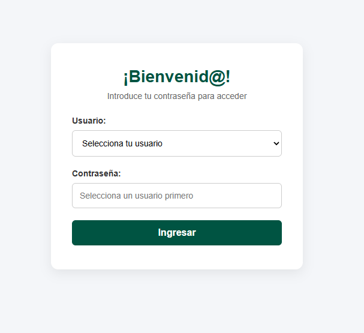
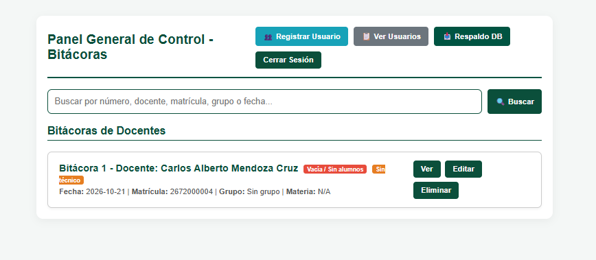
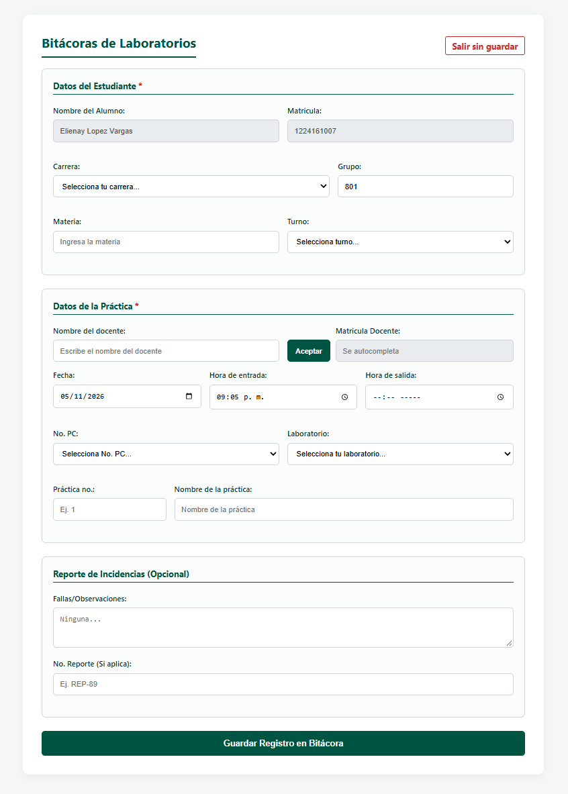
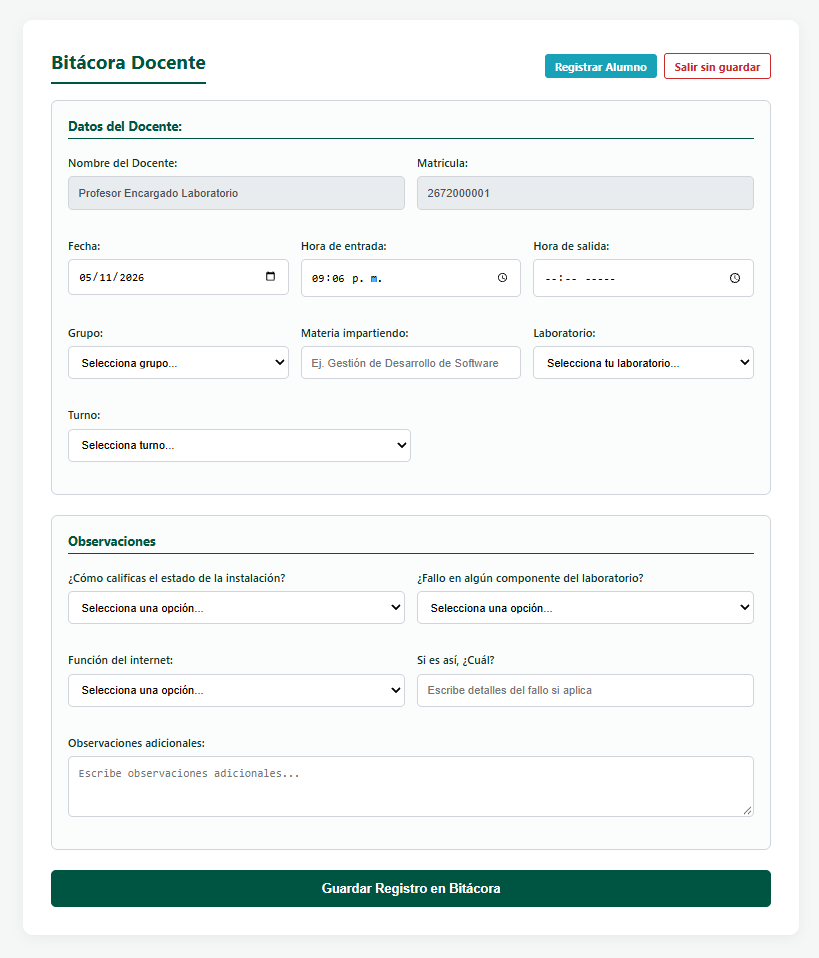
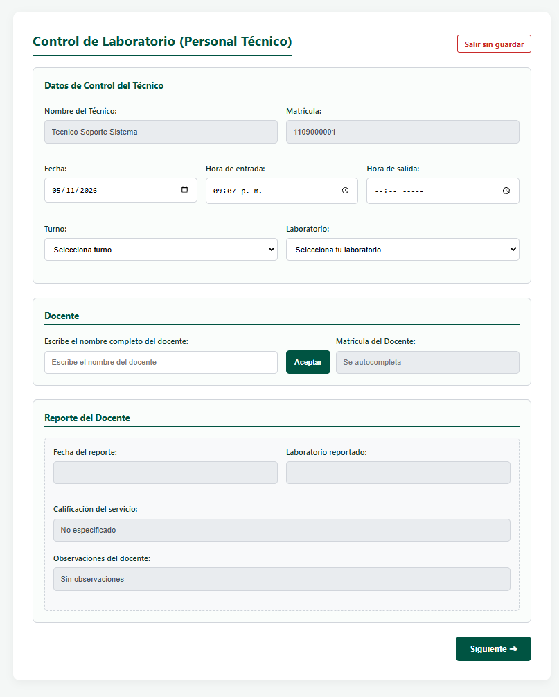
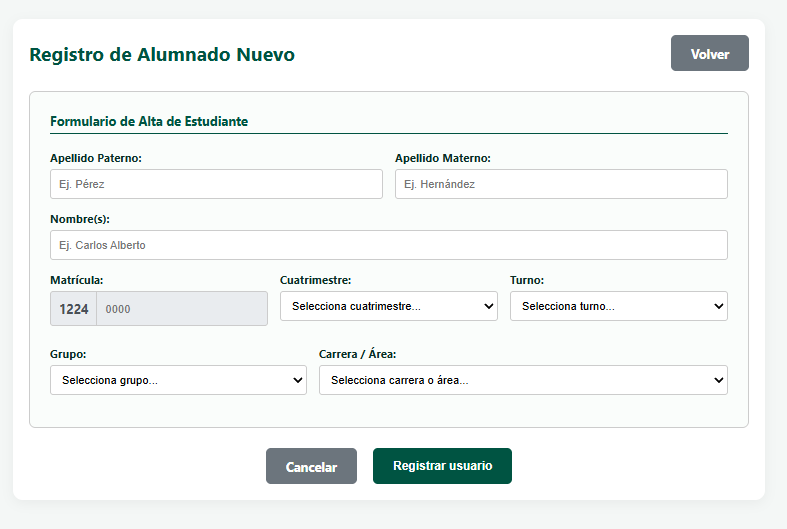
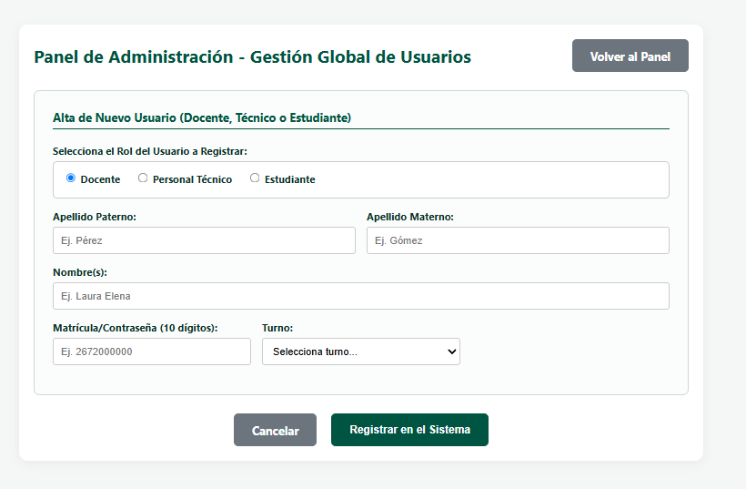
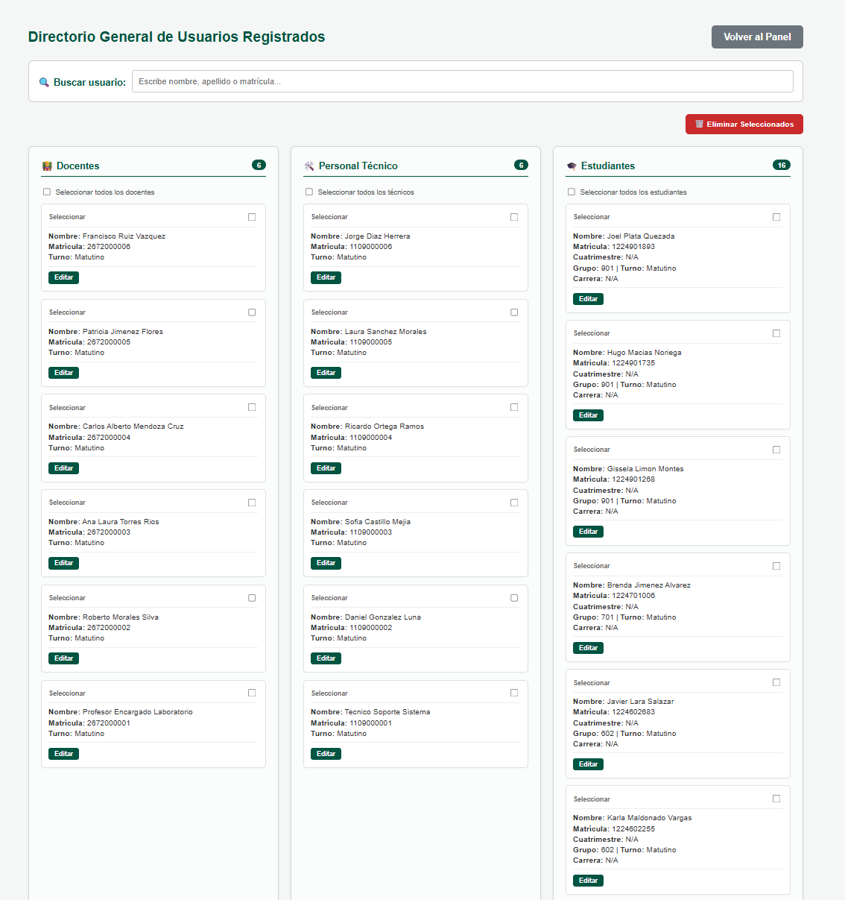

# ICONOLAB — Sistema de Control y Gestión de Bitácoras de Laboratorio

**Institución:** Universidad Politécnica del Valle de México (UPVM)  
**Asignatura:** Proyecto de Ingeniería de Software / Base de Datos  
**Grupo:** 801  
**Desarrolladores:**
- Rodríguez Arzate Alejandra Victoria 
- López Vargas Elienay 
- Martinez Miranda Itzel Laura

---

## 1. Descripción General
**ICONOLAB** es una aplicación web desarrollada bajo el patrón de arquitectura **Modelo-Vista-Controlador (MVC)** que automatiza la gestión, control y registro digital de las bitácoras del laboratorio de cómputo en la UPVM. El sistema sustituye los registros manuales en papel por un flujo digital centralizado que garantiza el seguimiento de asistencias de alumnos, actividades de los docentes y administración del uso de infraestructura.

---

## 2. Funcionalidades Principales

- 🔐 **Autenticación y Control de Acceso:** Sistema de roles (Administrador, Docente, Alumno) con clave de acceso administrativa.
- 📋 **Gestión de Bitácoras de Alumnos:** Registro y consulta de entradas/salidas en laboratorios de cómputo.
- 👨‍🏫 **Gestión de Bitácoras Docentes:** Control de horas de práctica, materia asignada y observaciones del laboratorio.
- 🏛️ **Administración Institucional:** Registro de carreras, asignaturas, laboratorios y grupos.
- 📊 **Generación de Reportes:** Visualización y exportación de historial de uso de bitácoras.

---

## 3. Tecnologías Utilizadas

- **Lenguaje:** Java (JDK 17+)
- **Tecnología Web:** Jakarta EE (Servlets, JSP, JDBC)
- **Servidor de Aplicaciones:** Apache Tomcat 11.0.25
- **Gestión de Dependencias:** Apache Maven
- **Base de Datos:** MySQL (ejecutado en entorno XAMPP)
- **Frontend:** HTML5, CSS3, JavaScript
- **IDE:** IntelliJ IDEA

---

## 4. Guía de Uso y Flujo de Navegación

El sistema opera mediante un flujo autenticado basado en roles, guiando al usuario desde su ingreso hasta la gestión de bitácoras y catálogos institucionales.

### 1. Acceso al Sistema (Login)
La pantalla de autenticación solicita usuario y contraseña para redirigir al usuario según su perfil autorizado.


### 2. Panel Administrativo
Vista central para administradores donde se controlan los registros generales del sistema.


### 3. Módulos de Bitácoras
* **Bitácora de Alumnos:** Registro de accesos y equipos asignados.
  
* **Bitácora de Docentes:** Control de sesiones de práctica e impartición de clases.
  
* **Bitácora de Técnicos:** Seguimiento de soporte y control del laboratorio.
  

### 4. Gestión de Registros y Usuarios
* **Registro de Alumnos / Bitácora Docente:** Formularios detallados de alta.
  
* **Panel de Gestión de Usuarios:** Control de altas y permisos.
  
* **Listado de Usuarios Registrados:** Vista general de usuarios activos en la plataforma.
  

---

## 5. Modelo de Datos

El sistema utiliza una base de datos relacional orientada a la gestión escolar.

### Principales Entidades:
- `usuarios`: Registra información general, credenciales y rol en el sistema.
- `bitacora_alumnos`: Almacena el historial de accesos de alumnos a las estaciones de cómputo.
- `bitacora_docentes`: Guarda el registro de sesiones impartidas por los profesores.
- `laboratorios` / `equipos`: Controla el inventario físico de salas y equipos de cómputo.

*(Nota: El diagrama Entidad-Relación completo se encuentra disponible en `docs/modelo_relacional.png`)*

---

## 6. Instrucciones de Instalación y Despliegue

### Requisitos Previos
- Java Development Kit (JDK 17 o superior).
- Apache Tomcat 11.0.25.
- Servidor MySQL (XAMPP recomendable).
- Maven 3.x.

### Pasos para Ejecución Local

1. **Clonar el repositorio:**
   ```bash
   git clone [https://github.com/vickyrz/ICONOLAB.git](https://github.com/vickyrz/ICONOLAB.git)
   cd iconolab